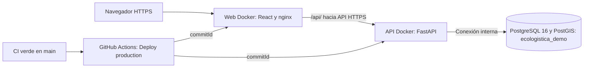

# Guía de despliegue en producción — Render

[← Volver al README](../README.md)

ECL-137 · Sprint 5 · Giancarlo Soto. Revisión técnica: Antony; revisión documental: Julio o Frank. Guía contrastada con `main` `307dded` y los archivos enlazados; no acredita una ejecución en Render. Los marcadores `<servicio-web>` y `<servicio-api>` se sustituyen por los nombres asignados a los servicios. Nunca publicar credenciales, cadenas de conexión o capturas de Secrets.

## Requisitos

- Acceso autorizado al repositorio `ANTONY-MUNIVE/EcoLog-stica-Lima`, al workspace de Render y a las variables/Secrets del entorno GitHub `production`.
- Rama `main` validada por CI; una persona administra el despliegue y otra comprueba la guía.
- Para la carga externa de demo: Windows/PowerShell, Git, Docker Desktop funcionando y el clon del mismo commit que está desplegado. No hace falta instalar Python en Windows para la alternativa con Docker.
- El Blueprint usa instancias gratuitas para una **demostración académica**. El nombre del workflow «production» no convierte ese plan en una infraestructura adecuada para operación empresarial.

## Arquitectura en Render



Fuente: [render.yaml](../render.yaml), [Dockerfile web](../frontend/Dockerfile.render), [proxy nginx](../frontend/nginx.render.conf.template) y [Dockerfile API](../backend/Dockerfile).

El navegador usa exclusivamente `https://<servicio-web>.onrender.com/api`. nginx elimina el prefijo `/api/` al reenviar a `https://<servicio-api>.onrender.com/`. Los subdominios de `onrender.com` no forman un mismo sitio para la cookie `SameSite=Strict`; llamar a la API desde la web con dos orígenes distintos pierde ese diseño de sesión. Mantener el proxy y HTTPS; no relajar la cookie para resolverlo.

## Primer despliegue paso a paso

1. En Render, **New → Blueprint**, autorizar el repositorio actual y seleccionar `main` y `render.yaml`. Si el entorno ya existe, inspeccionarlo: no crear un segundo Blueprint o una segunda base para repetir una demo.
2. Revisar los recursos: Postgres `ecologistica-db`, base `ecologistica_demo`, usuario `ecologistica`, versión 16; servicios Docker `ecologistica-api` y `ecologistica-web`, región Oregon. La lista `ipAllowList: []` impide acceso externo a la base; la API usa la conexión interna del Blueprint.
3. Obtener las direcciones HTTPS que Render asigna y completar las tres variables manuales de la tabla siguiente. No asumir que los nombres asignados coinciden exactamente con los nombres del YAML.
4. Confirmar que API y web tienen `autoDeploy: false`. El despliegue inicial del Blueprint puede iniciar la creación; los cambios posteriores se coordinan por el workflow. Si la web se construyó antes de tener su URL, corregir la variable y reconstruirla.
5. La API usa `rootDir: backend`, `Dockerfile` y **`sh deploy/render_start.sh`** como orden de arranque del Blueprint. No sustituirla por el CMD genérico del Dockerfile: ese CMD no aplica migraciones.
6. El [script real de inicio](../backend/deploy/render_start.sh) convierte internamente el esquema de conexión al driver psycopg, activa PostGIS con `CREATE EXTENSION IF NOT EXISTS postgis`, ejecuta `python -m alembic upgrade head` y arranca uvicorn en `$PORT` (8000 de respaldo). Si falla un paso, el arranque se detiene. Revisar logs sin copiar cadenas de conexión.
7. Esperar que ambos servicios estén activos. Comprobar API `/health`, web `/` y web `/api/health`; después configurar GitHub y ejecutar la verificación de la sección correspondiente.

## Variables y Secrets

### Render

El ticket enumera cinco variables relevantes, pero **solo tres tienen `sync: false`** en el Blueprint actual. No rellenar a mano la URL de base ni cambiar el entorno para sembrar datos.

| Servicio | Variable | Configuración |
|---|---|---|
| API | `RENDER_DATABASE_URL` | Automática: `fromDatabase.connectionString` de `ecologistica-db`. Es privada; no pegar su valor en documentación, chats o archivos. |
| API | `APP_ENV` | Automática: `production`. Mantenerla así para cookies Secure y validaciones de producción. |
| API | `CORS_ALLOWED_ORIGINS` | Manual, JSON: `["https://<servicio-web>.onrender.com"]`. Sin `/api`, sin comodines. |
| Web | `API_UPSTREAM` | Manual: `https://<servicio-api>.onrender.com`, sin barra final ni `/api`. |
| Web | `VITE_API_BASE_URL` | Manual: `https://<servicio-web>.onrender.com/api`. Se incorpora **durante el build**; cambiarla exige reconstruir la web. |

`DATABASE_URL` se genera dentro del proceso de arranque de la API; no añadir una segunda conexión manual distinta. Render asigna `PORT`.

### GitHub

En Settings → Environments → `production`, configurar Secrets y Variables para que estén disponibles al job de despliegue. Comprobar las restricciones/aprobaciones del entorno con el administrador.

| Tipo | Nombre | Contenido |
|---|---|---|
| Secret | `RENDER_API_KEY` | Clave del workspace con permiso **Deploys → Run**, que permite disparar despliegues y consultar su estado. No necesita acceso a credenciales Postgres, secretos de servicios ni modificar infraestructura. |
| Variable | `RENDER_SERVICE_ID_API` | Identificador del servicio API, no su URL ni el nombre visible. |
| Variable | `RENDER_SERVICE_ID_WEB` | Identificador del servicio web. |
| Variable | `PRODUCTION_URL` | `https://<servicio-web>.onrender.com`, sin barra final ni `/api`. |

Los permisos disponibles dependen del rol de quien crea la clave; contrastarlos con [API Keys de Render](https://render.com/docs/api-keys). El workflow usa POST de deploy y GET de estado, no administra la base. No usar una clave personal de acceso total por comodidad.

## Despliegue continuo

Fuente: [deploy-production.yml](../.github/workflows/deploy-production.yml).

- Tras **CI** completado con éxito en `main`, `workflow_run` despliega el `head_sha` validado. No se ejecuta por un CI fallido.
- También existen **Run workflow** y push de tags `v*`. Esas dos entradas **no tienen en el YAML una comprobación automática de CI exitoso**: seleccionar/verificar un commit aprobado de `main` antes de usarlas. Para el disparo manual, elegir la rama `main`.
- El workflow valida configuración, envía `commitId` a API y web, y espera que ambos deploys estén `live`. No despliega simplemente «lo último» sin identificar el commit. Concurrencia `deploy-production`, sin cancelar el despliegue anterior.
- La espera consulta hasta 100 veces cada 15 s; falla ante estados fallidos/cancelados/desactivados. El job completo tiene límite de 30 min.
- El humo comprueba `/api/health` con `status: ok` y portada HTTP 200. Después toma 30 muestras de `/api/health`, separadas por 2 s; exige **30/30 respuestas 200**. Es disponibilidad de ese muestreo, no un SLA ni disponibilidad mensual.
- El resumen muestra commit y resultados. El artefacto `deploy-smoke-<run_id>` conserva `disponibilidad.csv` durante 30 días; descargar evidencia necesaria antes de que expire. Un workflow histórico verde no demuestra el estado actual ni confirma un despliegue posterior.

## Carga de datos demo

Fuentes: [seed_demo_mvp.py](../backend/scripts/seed_demo_mvp.py), [seed_demo.py](../backend/scripts/seed_demo.py), [_guard.py](../backend/scripts/_guard.py) y [README del backend](../backend/README.md).

Esta operación escribe datos ficticios. Usar exclusivamente una base dedicada `*_demo`, migrada, sin información real, y coordinarla con el responsable del entorno. El guard rechaza cualquier otro nombre **y también `APP_ENV=production`** antes de conectar. No quitar el guard ni cambiar el `APP_ENV` del servicio público. El proceso auxiliar de siembra usa `development` únicamente para esa base demo; la API sigue en `production`.

El seed solicita cinco contraseñas de al menos 12 caracteres mediante `SEED_DEMO_PASSWORD_ADMINISTRADOR`, `OPERADOR`, `CONDUCTOR`, `ANALISTA` y `AUDITOR` (todas con el prefijo completo). Crearlas y guardarlas privadamente. Repetir el seed no equivale a restablecer las contraseñas de cuentas existentes.

### Alternativa reproducible para el plan gratuito: equipo auxiliar e IP temporal

La imagen actual de la API **no copia `backend/scripts/`** y las instancias web gratuitas no ofrecen Shell. No ejecutar `python -m scripts.seed_demo_mvp` dentro de esa imagen esperando que el módulo exista. La alternativa siguiente monta los scripts del mismo clon en un contenedor local desechable; no modifica el Dockerfile ni el servicio.

1. Confirmar en Render el nombre `ecologistica_demo`, su estado y migraciones. Anotar el commit desplegado y usar ese mismo commit en el equipo auxiliar. Hacer copia de seguridad si la demo ya contiene datos que deban conservarse.
2. En los controles de acceso de la base, permitir temporalmente **solo la IP pública actual del equipo**, como `/32`. No abrir `0.0.0.0/0`. Guardar y comprobar conectividad. El Blueprint seguirá teniendo lista vacía: al terminar, retirar la entrada temporal.
3. Tener a mano la conexión **externa** desde Render, introducirla solo en la entrada oculta del bloque siguiente. La conexión interna solo funciona dentro de la red de Render. Nunca pegar ninguna de las dos en un chat, comando literal, `.env`, archivo o captura.
4. Desde la raíz del clon, en una PowerShell dedicada sin transcripción/grabación, construir el auxiliar y ejecutar el bloque. Elegir hoy o una fecha futura en Lima, no copiar una fecha histórica del ejemplo de ECL-105.

```powershell
docker build -t ecologistica-seed-helper ./backend
if ($LASTEXITCODE -ne 0) { throw 'No se construyó el auxiliar' }

function Read-PrivateValue([string]$Prompt) {
  $secure = Read-Host $Prompt -AsSecureString
  $ptr = [Runtime.InteropServices.Marshal]::SecureStringToBSTR($secure)
  try { [Runtime.InteropServices.Marshal]::PtrToStringBSTR($ptr) }
  finally { [Runtime.InteropServices.Marshal]::ZeroFreeBSTR($ptr) }
}

$rolesDemo = 'ADMINISTRADOR','OPERADOR','CONDUCTOR','ANALISTA','AUDITOR'
$fechaDemo = Read-Host 'Fecha de operación en Lima (AAAA-MM-DD, hoy o futura)'
try {
  $env:DATABASE_URL = (Read-PrivateValue 'Conexión EXTERNA privada de la base demo') `
    -replace '^postgres(ql)?://', 'postgresql+psycopg://'
  if ($env:DATABASE_URL -notmatch '[?&]sslmode=') {
    $separatorDemo = if ($env:DATABASE_URL.Contains('?')) { '&' } else { '?' }
    $env:DATABASE_URL += "${separatorDemo}sslmode=require"
  }
  foreach ($roleDemo in $rolesDemo) {
    Set-Item "env:SEED_DEMO_PASSWORD_$roleDemo" `
      (Read-PrivateValue "Contraseña demo para $roleDemo (mínimo 12)")
  }
  docker run --rm --env APP_ENV=development --env DATABASE_URL `
    --env SEED_DEMO_PASSWORD_ADMINISTRADOR --env SEED_DEMO_PASSWORD_OPERADOR `
    --env SEED_DEMO_PASSWORD_CONDUCTOR --env SEED_DEMO_PASSWORD_ANALISTA `
    --env SEED_DEMO_PASSWORD_AUDITOR `
    --mount "type=bind,source=$($PWD.Path)/backend/scripts,target=/app/scripts,readonly" `
    ecologistica-seed-helper python -m scripts.seed_demo_mvp --fecha $fechaDemo
  if ($LASTEXITCODE -ne 0) { throw 'La siembra no terminó; revisar el motivo sin publicar credenciales' }
} finally {
  Remove-Item env:DATABASE_URL -ErrorAction SilentlyContinue
  foreach ($roleDemo in $rolesDemo) {
    Remove-Item "env:SEED_DEMO_PASSWORD_$roleDemo" -ErrorAction SilentlyContinue
  }
  Remove-Item Function:Read-PrivateValue -ErrorAction SilentlyContinue
}
```

5. **Incluso si falla el comando**, quitar en Render la IP temporal y comprobar que no quedan accesos externos permitidos. La limpieza de PowerShell no cambia la lista de IP de Render: son dos tareas distintas. Cerrar la terminal auxiliar y limpiar el portapapeles privado; no conservar inspecciones del contenedor o volcados de su entorno.
6. Leer el resumen sin asumir cantidades: en un conjunto compatible, el escenario completa hasta 150 pedidos pendientes, 15 vehículos activos y conductores demo. Dos pedidos son deliberadamente inviables. Más de 50 pedidos ajenos, una fecha pasada o una base ya alterada pueden impedir la siembra. Si se repite con otra fecha, las referencias idempotentes existentes no trasladan pedidos: verificar la fecha real de los datos; no borrar la base para resolverlo sin autorización.

### Shell de Render, solo si está disponible

En un servicio con Shell habilitada se puede usar un entorno auxiliar autorizado que tenga el **código y `scripts/` del mismo commit**, dependencias instaladas y la conexión interna de la base demo. La imagen actual no satisface el requisito de scripts: no es una alternativa lista para ejecutar en Free. Introducir las cinco contraseñas por entrada oculta, asignarlas al entorno del proceso, normalizar la conexión al driver y ejecutar `python -m scripts.seed_demo_mvp --fecha <AAAA-MM-DD>` con `APP_ENV=development` solo en el proceso auxiliar. Limpiar variables al terminar; no modificar el entorno persistente de la API ni copiar secretos a archivos. La ruta externa anterior evita necesitar esta Shell.

## Optimización y verificación

1. Abrir `https://<servicio-web>.onrender.com` y `/api/health`; después `/api/health/ready`. Deben responder correctamente antes de probar usuarios. La disponibilidad de la base se comprueba con ready, no solo con la portada.
2. Iniciar sesión como Operador (`operador.demo@ecologistica.example`) desde la **web** con su contraseña privada. Elegir en Rutas y alertas la misma fecha sembrada y pulsar **Optimizar fecha** (ECL-138); esperar el cálculo y actualizar la selección si procede. No prometer un número fijo de rutas ni reintentar repetidamente mientras una petición siga en curso.
3. Alternativa Swagger: entrar desde el origen web por `/api/docs`. El esquema de FastAPI puede apuntar a `/openapi.json` sin prefijo; si esa interfaz no carga, usar `/docs` en el origen de la API e iniciar sesión allí mediante `POST /login` como Operador, sin copiar cookies/tokens. En ese origen ejecutar `POST /optimizaciones` con `{"fecha_operacion":"<AAAA-MM-DD>"}`. La sesión de la web no se comparte automáticamente con el host de la API. Resultado exitoso: HTTP 201, `COMPLETADA`, `simulado:false`; conservar solo identificador/estado sin datos personales.
4. Abrir el detalle y comprobar rutas y motivos de no asignación. Registrar resultados de paradas y cerrar una ruta de prueba desde la pantalla del Operador para alimentar sostenibilidad. El dashboard usa la **fecha de cierre**: consultar un periodo que la incluya. Una optimización completada sin rutas cerradas puede mostrar «Sin datos» correctamente. El reporte PDF solo estará disponible para un periodo con datos según el contrato de US-010.
5. En Actions comprobar ambos servicios `live` sobre el commit esperado y el artefacto de humo 30/30. Registrar fecha/hora, commit, URLs públicas consultadas, respuestas y quién comprobó el flujo; no publicar contraseñas ni la URL de la base.

## Plan gratuito y preparación de la demo

Los servicios Free se suspenden tras 15 min sin tráfico; el arranque puede rondar 50 s o aproximadamente un minuto, sin garantía. Abrir web y `/api/health` cinco minutos antes, esperar `/api/health/ready` y entrar con el rol correcto. La base gratuita expira a los 30 días: revisar su fecha de creación y continuidad con el administrador antes de la evaluación; no contar con ella como almacenamiento permanente. Free no ofrece Shell web. Estas limitaciones se contrastan en [Render Free](https://render.com/docs/free); no se midieron tiempos nuevos en esta guía.

## Problemas frecuentes

| Síntoma | Comprobación y acción |
|---|---|
| Se ve una versión vieja | Comparar commit del deploy web con el esperado; recargar sin caché. El aviso ECL-139 es otra subtarea: esta guía no presupone que esté integrado. Si persiste, probar una ventana privada; antes de borrar almacenamiento comprobar que no haya reportes offline por sincronizar. |
| Sesión que no persiste / 401 | Acceder por HTTPS a la web; comprobar que las peticiones van a su `/api`, no al host de API. Revisar `VITE_API_BASE_URL` del build, `API_UPSTREAM`, CORS y expiración de sesión. Volver a entrar en el mismo origen; no desactivar Secure/SameSite. |
| 503 al optimizar | Comprobar ready, arranque en frío, logs de API y estado de la corrida. Distinguir fallo de cálculo de servicio caído; no ocultarlo como «Sin datos». Si hay `optimizacion_id`, consultar el resultado antes de volver a crear una corrida. |
| 422 al optimizar | Revisar pedidos pendientes de esa fecha, flota activa, límites 150/15 y parámetros EN-008 vigentes; no inventar parámetros para superar la validación. |
| Build web falla o apunta a otra API | Revisar las variables manuales; `VITE_API_BASE_URL` necesita un build nuevo. Verificar que API_UPSTREAM no termine en `/api` ni en `/`. |
| No arranca API / migraciones | Verificar que se usa `sh deploy/render_start.sh`, conexión interna válida, PostGIS disponible y Alembic sin error. No aplicar downgrade destructivo como corrección automática. |
| Seed rechaza / módulo inexistente | Revisar base `*_demo`, guard de entorno, cinco contraseñas, fecha y montaje de scripts. No cambiar el guard ni APP_ENV de la API. |
| Deploy falla por configuración / 401–403 | Revisar los cuatro nombres de configuración en GitHub, entorno `production`, ID de cada servicio y permisos Deploys → Run de la clave. |
| Cambiar a un commit anterior | Coordinar rollback de API y web al mismo commit validado y comprobar compatibilidad de la base. Un rollback de código no revierte las migraciones; no borrar datos ni bajar Alembic sin plan aprobado. |

## Rotación de credenciales

- Clave Render: crear reemplazo limitado, actualizar `RENDER_API_KEY` en GitHub, verificar un despliegue autorizado y revocar la anterior. Si hay filtración, revocarla inmediatamente y coordinar recuperación. No mostrar la clave en logs.
- Credenciales Postgres: acordar ventana y respaldo; rotar desde Render, comprobar la conexión interna vinculada por Blueprint y reiniciar/desplegar la API para tomar el valor actualizado. Verificar ready y operaciones de prueba antes de cerrar la intervención; retirar permisos IP temporales.
- Contraseñas demo: usar el restablecimiento autorizado de la app y el cambio obligatorio posterior. Reejecutar el seed no rota contraseñas existentes. No compartirlas en el PR ni incluirlas en el video.

## Prueba de lectura y aceptación

José, que no realizó el despliegue, debe revisar esta guía **con Render abierto en modo lectura**: localizar Blueprint, servicios, variables sin revelar valores, commit activo, logs, controles de acceso de la base y workflow/artefacto. Describir cómo cargaría la demo y retiraría la IP temporal, sin ejecutarlo por esta revisión. Anotar número de paso donde se perdió y corrección solicitada; Giancarlo corrige la guía y registra en el PR quién probó, cuándo, resultado y cambios concretos.

**Estado:** comprobación documental del repositorio; prueba de lectura por José, revisión técnica de Antony y aprobación de Julio o Frank pendientes de sus resultados reales. No se ha desplegado, sembrado ni modificado Render mediante ECL-137.

[← Volver al README](../README.md)
